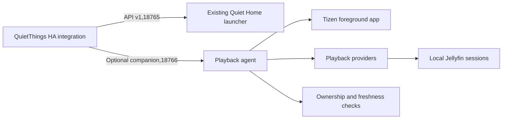

# Optional playback companion (development)

This extension adds actual player observations to QuietThings without changing the original API v1, its port 18765, fields or source files. It requires a .NET 6 launcher. It is experimental and has been installed and tested inside one customized Q60C launcher, rather than as a separate system service.

The Jellyfin-session provider supports Moonfin and the standalone Jellyfin client through their local server. Both clients passed actual HA pause, resume, advancing position, finite seek and stop checks. Cobalt observation supports ordinary YouTube and TizenTube. Protected app inspectors support Twitch and KickTV live playback. See the app-specific evidence and remaining lifecycle work below.

See [six-app development status](MULTI-APP.md) for the current hardware evidence and missing providers. The [web media probe](web/README.md) supplies the installed experimental web providers.

## Architecture



Provider reads are driven by authenticated requests. The installed Cobalt page observer additionally emits bounded actual-player snapshots about every 750 ms while its document is active, including when HA is idle. It performs a player command only when an authenticated current-lease request arrives. Twitch and KickTV inspector reads remain demand-driven. Each observation checks the current foreground application, selects its data, and checks foreground ownership again after the network read. A delayed response from the previous app cannot restore its metadata.

IPlaybackProvider is the extension point for native or web-app observations. Additional providers precede the default Jellyfin provider. Names must be unique. Providers cannot attribute media to a different foreground app; expired observations are discarded. The installed experimental providers include twitch-web-player, kicktv-web-player and cobalt-player. They observe actual app-owned players and expose only the capabilities of the current sample. Their protected root bridge is an additional component for an inspected rooted TV.

## Setup

Keep the original kit/src/LanApi.cs and LanApiCore.cs unchanged. Compile the companion src/*.cs into the existing launcher and provide callbacks for foreground identity, the existing signed-in account and the TV's route address. The private account stays on the TV. No Jellyfin token or server-session ID is sent to HA.

The companion listens on 18766 by default and uses the same lan-api.token file as API v1. With no valid token it denies every request. It uses plain HTTP on the trusted LAN, like the original API. Never expose either listener to the internet.

In QuietThings options, set Optional playback companion port to 18766. The default 0 disables it and sends no extra requests. Old launchers continue working with the port disabled. An optional extension failure clears media data while hardware control remains available.

The integration supports HA 2026.5.4 with the stock samsungtvws 2.7.2 dependency, and is also tested against HA 2026.10.4 with samsungtvws 3.0.7. The manifest accepts both rather than forcing a library replacement underneath an existing Samsung integration. async-timeout is explicitly declared because the older library imports it.

## Session selection and commands

The provider requires an exact TV address, the signed-in launcher's user ID, the foreground player and a recent server check-in. It handles IPv4-mapped IPv6 addresses and ports. Client names are explicit aliases, including Moonfin for Tizen. It does not match an address prefix or choose a device solely by its display name.

A recent replacement session is discovered automatically after app reinstall. Equally recent ambiguous sessions, missing pause state, old/future check-ins and unmatched accounts produce unknown status. The launcher and player must be signed into the same Jellyfin account for this provider.

Pause/play/stop are advertised only when the selected session reports remote-control support. Seek additionally requires CanSeek and a duration. Before sending a command, the provider reselects the current foreground session. A changed account/server is rejected. After delivery, the provider waits up to five seconds for the same client session to report the requested actual state or seek position. A replacement session or missing acknowledgement rejects the command; caller cancellation remains cancellation. Idle clients use their recent LastActivityDate because they may have no playback check-in. No state is invented. After a command, HA immediately reads an actual observation through the coordinator's serialized refresh instead of its default 10-second request debounce. App/server reporting can still add latency.

Hardware standby/off takes precedence over media state. A stock REST timeout is unknown, rather than proof of off. A cached playing observation cannot imply that the panel is on. HA expires media metadata independently of its configured polling interval.

## Protocol

Every request requires Authorization: Bearer TOKEN. Headers are capped at 8192 bytes, bodies at 1024 bytes, and input reading at 3 seconds. Connections are sequential and closed after each response. Commands have a bounded overall request deadline. Duplicate headers and transfer encoding are rejected. Authenticated requests are limited to 4 per second. Tokens, credentials and internal sessions are never returned.

- GET /v1/capabilities: extension=quietthings-playback, extension_version=1, adapter names and supported endpoint categories.
- GET /v1/playback: ok, extension_version and playback object.
- POST /v1/command: action play, pause, stop or seek; seek also takes position_seconds. Unknown commands are rejected. No shell/file/package endpoint exists.

Playback fields: app_id, optional app_name, state, adapter, title, media_type, position_seconds, duration_seconds, observed_at, position_updated_at and commands. State is unknown, idle, playing, paused or buffering. Timestamps include a UTC offset. Commands are capabilities of that observation, not global promises. Unknown/idle metadata must be cleared by clients.

Errors use 401 for auth, 400 for invalid commands/requests, 404/405 for route/method, 409 for unavailable/rejected controls, 413/431 for size limits, 429 for rate limits and 503 for failed observation setup. Network/source failure can also produce a successful unknown observation. Error messages omit exception strings, credentials and viewing data.

## Validation

```sh
python -m pip install -r requirements_test.txt
python -m pytest -q
python tests/ws_loopback.py
# Separate venv for the older supported target:
python -m pip install -r requirements_test_2026_5.txt
python -m pytest -q
python tests/ws_loopback.py
# .NET 6 SDK, or a compatible SDK with DOTNET_ROLL_FORWARD=Major:
dotnet run --project experimental/playback/tests/PlaybackTests.csproj
dotnet run --project kit/tests/LanApiTests.csproj
```

CI runs both HA targets and the .NET tests. Tests cover real integration entity behavior, account/IP boundaries, app changes during a request, reinstall selection, unknown/expired observations, optional failures, transport routing, diagnostics redaction and authenticated loopback HTTP. The actual samsungtvws implementations also complete a loopback handshake/key exchange on both dependency versions. No test requires a real TV, private service or credential.

Installed-device evidence on one Samsung Q60C with Tizen 9 and .NET 6.0.9:

- Physical and existing HA remote navigation worked; all eight custom remote grabs and existing account sign-ins remained intact.
- The companion remained reachable across the six tested apps. YouTube and TizenTube report actual HTML5 playback through the Cobalt observer; confirmed readable empty menus now report idle. Failed, ambiguous and actively initializing players remain unknown.
- Moonfin reported playing, paused, advancing position and automatic episode changes through the new HA entity and an existing universal media player.
- Play and pause commands changed real playback. A rapid pause/resume pair confirmed actual HA state in approximately 0.20 and 0.16 seconds on that LAN, with commands just over one second apart. These are individual observations, not a latency guarantee.
- Following an unexpected power cut, both APIs recovered, sign-ins and remote grabs persisted, and the existing boot helper recovered. This is recovery evidence, not a controlled standby/wake test.

Moonfin and standalone Jellyfin passed pause/resume, finite seek and stop on the development TV. Cobalt mode switching rejects the previous document lease, and app exit clears metadata. Controlled final boot/standby and live-app regression results are tracked in MULTI-APP.md. Volume and mute changes were read back through HA and restored to their original values. HDMI switching, a real app reinstall, an actual IPv6 LAN connection attempt and longer memory-pressure testing are not certified by these tests. This experimental implementation covers the named apps on one inspected TV; it does not establish universal Samsung app compatibility.

A confirmed idle app keeps its app name while clearing media metadata and commands. Cobalt names distinguish YouTube and TizenTube using the attested proxy mode. Readable complete menus with no loaded media, including paused empty player placeholders, report idle. Errors, ambiguous players and active initialization remain unknown. A dashboard can display the app name with Nothing Playing for idle, while keeping playback failures separate.

## Current limitations and release hold

The later installed title/menu update reads Twitch titles from channel-matched hidden player headings and KickTV broadcast titles from a cached lookup of the app's normal channel metadata API. Real titles reached HA on two channels in each app, including pause/resume and menu transitions. App-specific confirmed menus now pass idle through WebPlaybackProvider, clearing title/timing/controls. Twitch browse previews are not treated as the primary player. Both app tiles and launcher remote remaps use the managed inspector path; unrelated launch routes still do not automatically attach an inspector.

Kick enrichment is a bounded HTTPS lookup from the app, not entirely passive/local-only metadata extraction. It needs no additional HA cloud account/API key. It refreshes after 30 seconds, allows one in-flight request, times out after five seconds and expires unrefreshed titles after 90 seconds. Channel/source-generation/loading/ready checks reject stale responses and old titles. Initial title arrival can wait for the next HA poll. Twitch markup mismatches and Kick API failures omit titles rather than guessing.

Use the dedicated QuietThings media player's app_name/app_id attributes, entity state and media_title for app/status/title display. Idle means a confirmed menu/no primary playback; on alone means powered with unknown playback. The universal player may fall back to Samsung while idle and omit app attributes, so the custom dashboard reads the dedicated playback child for these labels. No separate per-app entity is required.

Current title-build checks: 131 shared playback checks, 21 bridge checks, 22 Python HTTP/lifecycle tests, title/context JavaScript and Cobalt client/proxy regressions, with zero-warning builds. No HA Python/UI change or restart was required. A new full TV reboot was not performed for this title build; retain the earlier lifecycle limits rather than implying fresh reboot certification.

The owner's custom dashboard uses timestamp-interpolated, read-only progress bars. Integration/API finite seek support does not mean those bars are draggable. Supported controls and metadata depend on the current provider sample.

A later startup repair enabled Samsung's separate Start with Smart Hub Home policy after a selector-only fix reverted at boot. Automatic Home foreground passed a full restart and input-to-Home wake readbacks. Direct Samsung HA wake remained intermittent; a QuietThings request was also skipped once while its entity was unavailable. Final recovery used repeated PC Wake-on-LAN. Guaranteed deep-standby HA wake is not established, and the universal player's Samsung power-on route was not changed.

Upstream PR1 remains closed. The owner requires daily-use testing before further PR work. This is a customized TV runtime plus a modified integration, not a drop-in HA-only playback upgrade or a released universal installer.
