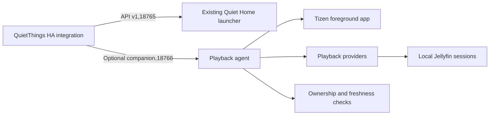

# Optional playback companion (development)

This extension adds actual player observations to QuietThings without changing the original API v1, its port 18765, fields or source files. It requires a .NET 6 launcher. It is experimental and has been installed and tested inside one customized Q60C launcher, rather than as a separate system service.

The first provider supports Moonfin and Jellyfin through their local Jellyfin server sessions. Installed-device checks verified Moonfin playing/paused state, advancing position, episode transitions and play/pause commands through Home Assistant. YouTube foreground identity was also observed, with playback correctly left unknown. Jellyfin client playback, seek, stop and controlled standby/wake remain unverified on hardware.

## Architecture



Collection is demand-driven by authenticated requests. There is no periodic background remote-control loop when HA is not using the companion. Each observation checks the current foreground application, selects its data, and checks foreground ownership again after the network read. A delayed response from the previous app cannot restore its metadata.

IPlaybackProvider is the extension point for future native or web-app observations. Additional providers precede the default Jellyfin provider. Names must be unique. Providers cannot attribute media to a different foreground app; expired observations are discarded. No adapter for YouTube, TizenTube, Twitch or KickTV is implemented or claimed in this version.

## Setup

Keep the original kit/src/LanApi.cs and LanApiCore.cs unchanged. Compile the companion src/*.cs into the existing launcher and provide callbacks for foreground identity, the existing signed-in account and the TV's route address. The private account stays on the TV. No Jellyfin token or server-session ID is sent to HA.

The companion listens on 18766 by default and uses the same lan-api.token file as API v1. With no valid token it denies every request. It uses plain HTTP on the trusted LAN, like the original API. Never expose either listener to the internet.

In QuietThings options, set Optional playback companion port to 18766. The default 0 disables it and sends no extra requests. Old launchers continue working with the port disabled. An optional extension failure clears media data while hardware control remains available.

The integration supports HA 2026.5.4 with the stock samsungtvws 2.7.2 dependency, and is also tested against HA 2026.10.4 with samsungtvws 3.0.7. The manifest accepts both rather than forcing a library replacement underneath an existing Samsung integration. async-timeout is explicitly declared because the older library imports it.

## Session selection and commands

The provider requires an exact TV address, the signed-in launcher's user ID, the foreground player and a recent server check-in. It handles IPv4-mapped IPv6 addresses and ports. Client names are explicit aliases, including Moonfin for Tizen. It does not match an address prefix or choose a device solely by its display name.

A recent replacement session is discovered automatically after app reinstall. Equally recent ambiguous sessions, missing pause state, old/future check-ins and unmatched accounts produce unknown status. The launcher and player must be signed into the same Jellyfin account for this provider.

Pause/play/stop are advertised only when the selected session reports remote-control support. Seek additionally requires CanSeek and a duration. Before sending a command, the provider reselects the current foreground session. A changed account/server is rejected. The response acknowledges server acceptance; it does not invent a new playback state. After a command, HA immediately reads an actual observation through the coordinator's serialized refresh instead of its default 10-second request debounce. App/server reporting can still add latency.

Hardware standby/off takes precedence over media state. A stock REST timeout is unknown, rather than proof of off. A cached playing observation cannot imply that the panel is on. HA expires media metadata independently of its configured polling interval.

## Protocol

Every request requires Authorization: Bearer TOKEN. Headers are capped at 8192 bytes, bodies at 1024 bytes, and input reading at 3 seconds. Connections are sequential and closed after each response. Commands have a bounded overall request deadline. Duplicate headers and transfer encoding are rejected. Authenticated requests are limited to 4 per second. Tokens, credentials and internal sessions are never returned.

- GET /v1/capabilities: extension=quietthings-playback, extension_version=1, adapter names and supported endpoint categories.
- GET /v1/playback: ok, extension_version and playback object.
- POST /v1/command: action play, pause, stop or seek; seek also takes position_seconds. Unknown commands are rejected. No shell/file/package endpoint exists.

Playback fields: app_id, state, adapter, title, media_type, position_seconds, duration_seconds, observed_at, position_updated_at and commands. State is unknown, idle, playing, paused or buffering. Timestamps include a UTC offset. Commands are capabilities of that observation, not global promises. Unknown/idle metadata must be cleared by clients.

Errors use 401 for auth, 400 for invalid commands/requests, 404/405 for route/method, 409 for unavailable/rejected controls, 413/431 for size limits, 429 for rate limits and 503 for failed observation setup. Network/source failure can also produce a successful unknown observation. Error messages omit exception strings, credentials and viewing data.

## Validation

```sh
python -m pip install -r requirements_test.txt
python -m pytest -q
python tests/ws_loopback.py
# Separate venv for the older supported target:
python -m pip install -r requirements_test_2026_5.txt
python -m pytest -q
python tests/ws_loopback.py
# .NET 6 SDK, or a compatible SDK with DOTNET_ROLL_FORWARD=Major:
dotnet run --project experimental/playback/tests/PlaybackTests.csproj
dotnet run --project kit/tests/LanApiTests.csproj
```

CI runs both HA targets and the .NET tests. Tests cover real integration entity behavior, account/IP boundaries, app changes during a request, reinstall selection, unknown/expired observations, optional failures, transport routing, diagnostics redaction and authenticated loopback HTTP. The actual samsungtvws implementations also complete a loopback handshake/key exchange on both dependency versions. No test requires a real TV, private service or credential.

Installed-device evidence on one Samsung Q60C with Tizen 9 and .NET 6.0.9:

- Physical and existing HA remote navigation worked; all eight custom remote grabs and existing account sign-ins remained intact.
- The companion remained reachable while Moonfin and YouTube were foreground. Unsupported YouTube playback returned unknown with no media metadata.
- Moonfin reported playing, paused, advancing position and automatic episode changes through the new HA entity and an existing universal media player.
- Play and pause commands changed real playback. A rapid pause/resume pair confirmed actual HA state in approximately 0.20 and 0.16 seconds on that LAN, with commands just over one second apart. These are individual observations, not a latency guarantee.
- Following an unexpected power cut, both APIs recovered, sign-ins and remote grabs persisted, and the existing boot helper recovered. This is recovery evidence, not a controlled standby/wake test.

Remaining hardware work: seek/stop, the separate Jellyfin client, volume/mute/HDMI regression checks, controlled app-switch clearing and standby/wake, reinstall/session replacement, and longer background/memory-pressure testing. Session replacement and stale/app-switch rejection currently have automated coverage. This is a draft implementation for architectural review, not an all-app playback solution or a generally accepted release.
